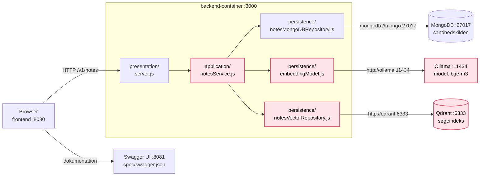
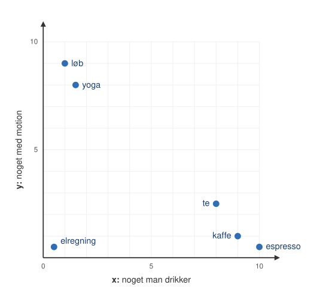
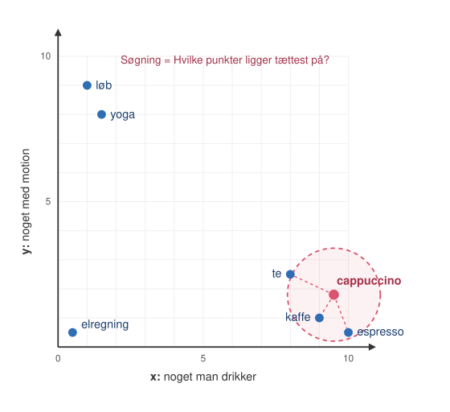
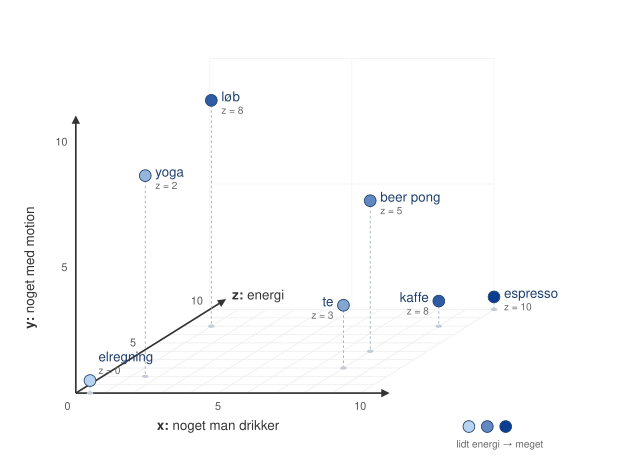

# Session 18: Dataarkitektur · Søg på betydning med en vektordatabase

**ITA Software Architecture 2026 Fall**

> Søg på "motion" i en almindelig database, og du finder kun sider, hvor ordet "motion" står. Men siden om løb handler jo også om motion.
>
> En almindelig database sammenligner bogstaver. I dag møder I en database, der sammenligner **betydning**: en vektordatabase. I finder ud af, hvordan den virker, og hvorfor det overhovedet er muligt at søge på den måde.

---

## Dagens spørgsmål

**Hvordan kan en database finde siden om løb, når I søger på "motion", og ordet ikke står på siden?**

---

## Læringsmål

Efter i dag kan du:

- forklare, hvad en **embedding** er: en tekst lavet om til en liste af tal, hvor tekster, der betyder det samme, får tal, der ligger tæt på hinanden
- forklare, **hvorfor man kan søge** i en vektordatabase: at søge er at finde de punkter, der ligger tættest på
- bruge en **vektordatabase** (Qdrant) og se, hvad der bliver gemt i den
- forklare, at den samme idé virker for andet end tekst, fx **musik**: Alt, der kan laves om til tal, kan søges på betydning
- selv lave en tekst om til en embedding via et **API** (Ollama) og læse svaret

---

## Før timen

Byg eksemplet hjemmefra. Første gang hentes en embedding-model (ca. 120 MB), og det tager et par minutter.

```bash
cd 18._data_architecture/example-search-engine
docker compose up --build
```

Åbn <http://localhost:8080>. Kan I søge, er I klar.

Hent også Ollama-imaget til Del 5. Det fylder ca. 8 GB, så gør det hjemmefra:

```bash
docker pull ollama/ollama
```

Det her er det, vi ender med at bygge på onsdag i [session 19](../19._data_architecture_2/README.md): jeres notes-service med Ollama og Qdrant. Det **rosa** er det nye.



---

## Del 1: To søgninger, samme side

Eksemplet er en lille **søgemaskine** over 20 opdigtede hjemmesider. Hver søgning køres to gange, og I ser begge resultater side om side:

- **Venstre:** MySQL og den SQL, der bliver kørt
- **Højre:** Qdrant og de trin, søgningen går igennem

**Start eksemplet først.** Åbn en terminal i roden af kursets repo (`EK_ITA_SWA_2026_fall`), og kør:

```bash
cd 18._data_architecture/example-search-engine
docker compose up --build
```

Åbn <http://localhost:8080>, når den er klar.

> **Miniøvelse (i par):** Søg på de her, og skriv ned, hvad hver side finder:

| Søgning | MySQL fandt | Qdrant fandt |
|---------|-------------|--------------|
| kaffe | | |
| billig kaffe | | |
| motion | | |
| ferie i Italien | | |
| spare penge | | |

- Hvorfor finder MySQL ingenting på "motion"? Se på SQL'en.
- Hvorfor finder MySQL "billig kaffe", men ikke "kaffe billig"? Prøv det.
- Qdrant finder sider, hvor ingen af ordene står. **Hvordan kan den det?**

---

## Del 2: Betydning som tal

Forestil jer et koordinatsystem med to akser, x og y:

- **x:** "noget man drikker" (0 = slet ikke, 10 = helt sikkert)
- **y:** "noget med motion" (0 = slet ikke, 10 = helt sikkert)

Vi sætter de her ord ind som punkter: **kaffe, espresso, te, løb, yoga, elregning, beer pong**.



- Hvilke punkter ligger tæt på hinanden?
- Hvor ligger "elregning"?
- Så sætter vi et nyt ord ind: **cappuccino**. Hvilket ord ligger det tættest på?

**Det, vi lige har tegnet, er en embedding.** Hvert ord er blevet til to tal, fx kaffe = `[9, 1]`. Ord, der betyder noget lignende, ligger tæt på hinanden. Og at **søge** er bare at spørge: *Hvilke punkter ligger tættest på det her?*



### En akse mere: z = energi

Kaffe og te ligger næsten oven i hinanden. Det samme gør løb og yoga. Men de er jo ikke det samme. Så vi tilføjer en tredje akse:

- **z:** "giver energi" (0 = slet ikke, 10 = helt sikkert)

| Ord | x (drikker) | y (motion) | z (energi) |
|-----|:-----------:|:----------:|:----------:|
| kaffe | 9 | 1 | **8** |
| espresso | 10 | 0.5 | **10** |
| te | 8 | 2.5 | **3** |
| løb | 1 | 9 | **8** |
| yoga | 1.5 | 8 | **2** |
| beer pong | 8 | 6 | **5** |
| elregning | 0.5 | 0.5 | **0** |



- Hvad sker der med afstanden mellem kaffe og te? Og mellem løb og yoga?
- Kaffe og løb er rykket lidt tættere på hinanden. Hvorfor?

Hver ny akse fanger en ny slags lighed. Jo flere akser, jo finere forskelle kan man se.

### Fra 2 tal til 384 tal

En rigtig **embedding-model** gør det samme, men:

- med **384 tal** i stedet for 2, altså 384 akser i stedet for kun "drikke" og "motion"
- for hele sætninger, ikke kun ord
- og ingen har valgt akserne. Modellen har selv lært dem ved at læse enorme mængder tekst.

Hvor tæt to tekster er, måles med **cosine similarity**: Peger de to pile i samme retning? `1` betyder præcis samme retning, og jo lavere tallet er, jo mindre har de med hinanden at gøre.

En **vektordatabase** er en database, der er bygget til ét spørgsmål: *Hvilke punkter ligger tættest på det her?* Og den kan svare hurtigt, også når der er millioner af punkter.

---

## Del 3: Kig ind i vektorsøgningen

Søg på "kaffe" igen, og følg de tre trin i højre side:

1. **Søgeteksten** får `query: ` foran. Hvorfor tror I, modellen vil vide, at det er en søgning?
2. **Embedding-modellen** laver teksten om til 384 tal. Striben viser dem: én tynd streg pr. tal, orange for positive og blå for negative.
3. **Qdrant** får de 384 tal og svarer med de 5 nærmeste punkter. Se request'en: Der står ingen tekst i den, kun tal. Se svaret: Hvert punkt har et `id`, en `score` og den side, der er gemt sammen med tallene (`payload`).

Sammenlign striben for jeres søgning med striberne under resultaterne. Kan I se, at de øverste ligner mest?

**Åbn Qdrant-dashboardet** på <http://localhost:6333/dashboard> → **Collections** → `pages`:

- Hvor mange punkter er der? Passer det med antallet af sider i MySQL?
- Åbn et punkt. Hvad er gemt ud over de 384 tal?

**Søg på "rumfart".** Ingen af siderne handler om rumfart.

- Får I alligevel 5 svar?
- Hvad er `score` nu, sammenlignet med "kaffe"?

> **Vigtigt:** En vektordatabase finder *altid* de nærmeste punkter, også selvom de ligger langt væk. Den siger aldrig "ingen resultater" af sig selv. Det er jeres job at bestemme, hvornår en `score` er for lav.

---

## Del 4: Demo: musik i Spotify

Søgemaskinen forstår kun tekst. Kan den samme idé bruges på musik?

Vi starter en radio ud fra en sang i Spotify og ser, hvad den foreslår.

- Hvad tror I, Spotify sammenligner? Der står jo ikke "glad sommermusik" i lydfilen.
- Hvis I skulle tegne koordinatsystemet fra Del 2 for musik, hvad kunne akserne så være?

Spotify har selv lavet open source-værktøjer til at finde de nærmeste punkter hurtigt: først **Annoy** og senere **Voyager**.

---

## Del 5: Lav jeres egne embeddings

> **Øvelse (i par):** Følg tutorialen [Embeddings med Ollama i Docker og Insomnia](ollama-docker-insomnia-tutorial.md).

Når I er færdige:

- Hvor mange tal får I for "Hej verden" med `nomic-embed-text`? Og med `bge-m3`? Søgemaskinens model laver 384. Hvorfor er tallet forskelligt?
- I Insomnia kører modellen i sin egen container, og I kalder den over HTTP. Hvor kører modellen i søgemaskinen?

Tilbage til dagens spørgsmål: **Hvordan kan en database finde siden om løb, når I søger på "motion"?**

---

## Optional

- [optional] Qdrant: [What is a vector database?](https://qdrant.tech/articles/what-is-a-vector-database/)
- [optional] Hugging Face: [`multilingual-e5-small`](https://huggingface.co/intfloat/multilingual-e5-small), den model vi bruger
