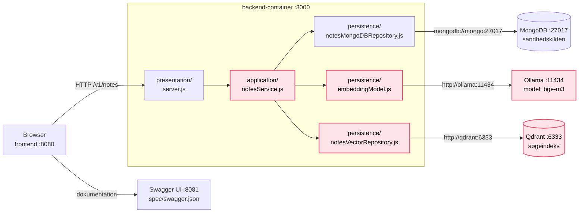

# Session 19: Dataarkitektur 2 · Semantisk søgning i jeres notes-service

**ITA Software Architecture 2026 Fall**

> Vi bygger videre på [session 18](../18._data_architecture/README.md). I dag bygger I søgefunktionen ind i jeres egen **notes-service**: Ollama laver noterne om til tal, og Qdrant finder de nærmeste noter.
>
> Hele dagen er én tutorial. Jeg starter med en kort intro til arkitekturen, og derefter arbejder I i par, i grupper eller alene.

---

## Dagens spørgsmål

**Hvad skal der til, for at jeres notes-service kan finde noten om espresso, når I søger på "kaffe"?**

---

## Læringsmål

Efter i dag kan du:

- tilføje en **vektordatabase** (Qdrant) og en **embedding-model** (Ollama) til en eksisterende applikation med Docker Compose
- placere den nye kode i de rigtige **lag**: Hvad hører til i persistence, og hvad hører til i application?
- forklare, hvorfor **MongoDB er sandhedskilden**, og Qdrant er et søgeindeks, der altid kan bygges op igen
- kalde en anden container ved dens **servicenavn**, fx `http://ollama:11434`

---

## Før timen

- Hav jeres **notes-service** fra session 12 klar og kørende (`docker compose up --build`): `GET`, `POST`, `PUT` og `DELETE` på `/v1/notes` og MongoDB som database.
  - Virker jeres ikke, eller vil I starte forfra, så brug [`example-node`](example-node/README.md) i denne mappe. Kopiér den ind i jeres repo, og kør den derfra.
- Lav en ny branch i jeres repo, så I altid kan komme tilbage:

  ```bash
  git switch -c semantisk-soegning
  ```

- Hent Qdrant-imaget hjemmefra: `docker pull qdrant/qdrant`. Ollama-imaget har I fra session 18.
- Stop Ollama-containeren fra session 18, så port 11434 er fri: `docker stop ollama`

---

## Overblik: det, I bygger i dag



**Rosa** er det, I bygger i dag. Resten har I fra session 9–12. Hver boks uden for backend er sin egen container i `docker-compose.yml`.

**Når en note gemmes** (`POST` eller `PUT`):

1. `notesService` gemmer noten i **MongoDB**.
2. `embeddingModel` sender titel og tekst til **Ollama** og får 1024 tal tilbage.
3. `notesVectorRepository` gemmer tallene i **Qdrant** med samme `id` som noten.

**Når I søger** (`GET /v1/notes/search?q=kaffe`):

1. `embeddingModel` laver søgeteksten om til 1024 tal.
2. `notesVectorRepository` spørger **Qdrant**: *Hvilke noter ligger tættest på de her tal?*
3. Svaret er noterne med en `score`. MongoDB bliver slet ikke spurgt.

**Slutresultatet** i backend:

```
backend/src/
├── presentation/
│   └── server.js                    ← ny route: GET /v1/notes/search
├── application/
│   └── notesService.js              ← ny (eller udvidet): bestemmer rækkefølgen
└── persistence/
    ├── notesMongoDBRepository.js    ← uændret
    ├── embeddingModel.js            ← ny: tekst → tal via Ollama
    └── notesVectorRepository.js     ← ny: tal → Qdrant
```

---

## Trin 1: Ollama og Qdrant i `docker-compose.yml`

Tilføj to nye services, og fortæl backend, hvor de ligger:

```yaml
services:
  backend:
    build: ./backend
    ports:
      - "3000:3000"
    environment:
      MONGO_URL: mongodb://mongo:27017
      OLLAMA_URL: http://ollama:11434   # ny
      QDRANT_URL: http://qdrant:6333    # ny
    depends_on:
      - mongo
      - ollama                          # ny
      - qdrant                          # ny

  # ... frontend, mongo og swagger-ui som før ...

  ollama:
    image: ollama/ollama
    ports:
      - "11434:11434"
    volumes:
      - ollama-data:/root/.ollama

  qdrant:
    image: qdrant/qdrant
    ports:
      - "6333:6333"

volumes:
  ollama-data:
```

Start det hele, og hent embedding-modellen ind i den nye Ollama-container (ca. 1,2 GB):

```bash
docker compose up -d --build
docker compose exec ollama ollama pull bge-m3
```

**Tjek:**

- Send `POST http://localhost:11434/api/embed` med `{"model": "bge-m3", "input": "kaffe"}` fra Insomnia, som i tutorialen fra session 18. Får I 1024 tal?
- Åbn Qdrant-dashboardet på <http://localhost:6333/dashboard>. Der er ingen collections endnu.

**Spørgsmål:**

- Fra jeres computer hedder Ollama `localhost:11434`. Fra backend hedder den `ollama:11434`. Hvorfor? (Tænk på `app.js` fra session 9.)
- Ollama har en volume, men Qdrant har ikke. Hvad sker der med den hentede model og med Qdrants data, når containeren bliver slettet? Vi vender tilbage til Qdrant i trin 6.

---

## Trin 2: Tekst bliver til tal · `embeddingModel.js`

Opret `backend/src/persistence/embeddingModel.js`:

```js
// Persistence layer: Ollama laver tekst om til tal (en embedding).
// Ollama er en anden container, så vi kalder den over HTTP ved servicenavn.

const OLLAMA_URL = process.env.OLLAMA_URL || "http://ollama:11434";
const MODEL = "bge-m3";
const DIMENSIONS = 1024; // bge-m3 laver altid 1024 tal

async function embed(text) {
  const res = await fetch(`${OLLAMA_URL}/api/embed`, {
    method: "POST",
    headers: { "Content-Type": "application/json" },
    body: JSON.stringify({ model: MODEL, input: text }),
  });
  if (!res.ok) throw new Error(`Ollama svarede ${res.status}: ${await res.text()}`);
  const data = await res.json();
  return data.embeddings[0];
}

module.exports = { embed, DIMENSIONS };
```

Det er præcis den request, I sendte fra Insomnia, bare fra koden. `fetch` er indbygget i Node, så der er ingen nye npm-pakker.

**Spørgsmål:** Ollama er ikke en database. Hvorfor ligger filen så i `persistence/`? Hvad har den til fælles med `notesMongoDBRepository.js`?

---

## Trin 3: Tallene i Qdrant · `notesVectorRepository.js`

Opret `backend/src/persistence/notesVectorRepository.js`:

```js
// Persistence layer: noterne som tal i Qdrant. Det er et søgeindeks,
// ikke sandhedskilden. Det kan altid bygges op igen ud fra MongoDB.

const QDRANT_URL = process.env.QDRANT_URL || "http://qdrant:6333";
const COLLECTION = "notes";

async function qdrant(method, path, body) {
  const res = await fetch(`${QDRANT_URL}${path}`, {
    method,
    headers: { "Content-Type": "application/json" },
    body: body ? JSON.stringify(body) : undefined,
  });
  if (!res.ok) throw new Error(`Qdrant svarede ${res.status}: ${await res.text()}`);
  return (await res.json()).result;
}

let collectionReady = false;

async function ensureCollection(dimensions) {
  if (collectionReady) return;
  const { exists } = await qdrant("GET", `/collections/${COLLECTION}/exists`);
  if (!exists) {
    await qdrant("PUT", `/collections/${COLLECTION}`, {
      vectors: { size: dimensions, distance: "Cosine" },
    });
  }
  collectionReady = true;
}

async function upsert(note, vector) {
  await qdrant("PUT", `/collections/${COLLECTION}/points?wait=true`, {
    points: [{ id: note.id, vector, payload: { title: note.title, body: note.body } }],
  });
}

async function remove(id) {
  await qdrant("POST", `/collections/${COLLECTION}/points/delete?wait=true`, { points: [id] });
}

async function count() {
  const result = await qdrant("POST", `/collections/${COLLECTION}/points/count`, { exact: true });
  return result.count;
}

async function query(vector, limit = 3) {
  const result = await qdrant("POST", `/collections/${COLLECTION}/points/query`, {
    query: vector,
    limit,
    with_payload: true,
  });
  return result.points.map((point) => ({
    id: point.id,
    score: point.score,
    title: point.payload.title,
    body: point.payload.body,
  }));
}

module.exports = { ensureCollection, upsert, remove, count, query };
```

| Funktion | Hvad den gør i Qdrant |
|---|---|
| `ensureCollection` | Opretter collection'en `notes` med 1024 tal pr. punkt, hvis den ikke findes |
| `upsert` | Gemmer ét punkt: notens `id`, dens tal og noten selv som `payload` |
| `remove` | Sletter punktet med det `id` |
| `count` | Tæller punkterne |
| `query` | Finder de nærmeste punkter, hver med en `score` |

**Spørgsmål:**

- Punktet i Qdrant får samme `id` som noten i MongoDB. Hvorfor er det vigtigt, når en note bliver rettet eller slettet?
- `upsert` er "update eller insert". Hvorfor passer det både til `POST` og `PUT`?
- `size: 1024` står i collection'en. Hvad tror I, der sker, hvis I senere skifter til en model, der laver 768 tal?

---

## Trin 4: Application-laget · `notesService.js`

Nu skal én fil bestemme rækkefølgen: først MongoDB, så Ollama, så Qdrant. Det er en regel for applikationen, så den hører til i **application-laget**.

Har I allerede `application/notesService.js` fra session 9, så udvid den. Ellers opret den:

```js
// Application layer: reglerne for noter. Her bestemmes, hvilken database
// der skrives til, og i hvilken rækkefølge. server.js kender kun denne fil.

const notesRepository = require("../persistence/notesMongoDBRepository");
const notesVectorRepository = require("../persistence/notesVectorRepository");
const embeddingModel = require("../persistence/embeddingModel");

// Lav en note om til tal, og gem tallene i Qdrant.
// Fejler det, er noten stadig gemt i MongoDB. Den kan bare ikke findes
// på betydning, før indekset bygges op igen.
async function index(note) {
  try {
    await notesVectorRepository.ensureCollection(embeddingModel.DIMENSIONS);
    const vector = await embeddingModel.embed(`${note.title}. ${note.body}`);
    await notesVectorRepository.upsert(note, vector);
  } catch (err) {
    console.error(`Kunne ikke indeksere note ${note.id}: ${err.message}`);
  }
}

async function rebuildIndex() {
  await notesVectorRepository.ensureCollection(embeddingModel.DIMENSIONS);
  const notes = await notesRepository.findAll();
  if ((await notesVectorRepository.count()) === notes.length) return;
  for (const note of notes) await index(note);
  console.log(`Qdrant bygget op igen: ${notes.length} noter`);
}

async function findAll() {
  return notesRepository.findAll();
}

async function findById(id) {
  return notesRepository.findById(id);
}

async function create(title, body) {
  const note = await notesRepository.create(title, body); // MongoDB først
  await index(note);
  return note;
}

async function update(id, title, body) {
  const note = await notesRepository.update(id, title, body);
  if (note) await index(note);
  return note;
}

async function remove(id) {
  const removed = await notesRepository.remove(id);
  if (removed) {
    await notesVectorRepository.remove(id).catch((err) => console.error(err.message));
  }
  return removed;
}

async function search(q) {
  await notesVectorRepository.ensureCollection(embeddingModel.DIMENSIONS);
  const vector = await embeddingModel.embed(q);
  return notesVectorRepository.query(vector);
}

module.exports = { rebuildIndex, findAll, findById, create, update, remove, search };
```

Bruger I et andet repository end MongoDB, så skift bare den første `require(...)`. Resten er det samme.

**Spørgsmål:**

- `create` skriver til MongoDB **før** Qdrant. Hvad ville der ske, hvis det var omvendt, og MongoDB fejlede?
- `index` fanger fejlen i stedet for at kaste den videre. Hvad får brugeren så at vide, hvis Qdrant er nede? Er det det rigtige valg?
- `findAll` og `findById` sender bare videre til MongoDB. Hvorfor går de alligevel gennem application-laget?

---

## Trin 5: Søge-endpointet · `server.js`

Tre ændringer i `backend/src/presentation/server.js`:

**1. `require`-linjen øverst** peger nu på application-laget, ikke på persistence. Skift også `notesRepository.` til `notesService.` i resten af filen:

```js
const notesService = require("../application/notesService");
```

**2. En ny route**, før `GET /v1/notes`:

```js
  if (req.method === "GET" && url.pathname === "/v1/notes/search") {
    const q = url.searchParams.get("q");
    if (!q) return send(res, 400, { error: "q is required" });
    try {
      return send(res, 200, await notesService.search(q));
    } catch (err) {
      console.error(`Søgning fejlede: ${err.message}`);
      return send(res, 503, { error: "Search is unavailable" });
    }
  }
```

**3. Byg indekset, når serveren starter**, så noterne, der allerede ligger i MongoDB, også kommer i Qdrant:

```js
server.listen(PORT, () => {
  console.log(`Presentation layer listening on port ${PORT}`);
  notesService.rebuildIndex().catch((err) => console.error(`Indeks ikke bygget: ${err.message}`));
});
```

Genstart backend, og prøv det:

```bash
docker compose up -d --build backend
docker compose logs backend        # står der "Qdrant bygget op igen"?

# Bruger I example-node, ligger Espresso der allerede. Så spring den første over.
curl -X POST localhost:3000/v1/notes -H 'Content-Type: application/json' \
  -d '{"title":"Espresso","body":"Maskinen skal afkalkes"}'
curl -X POST localhost:3000/v1/notes -H 'Content-Type: application/json' \
  -d '{"title":"Cykel","body":"Ny slange til baghjulet"}'

curl "localhost:3000/v1/notes/search?q=kaffe"
curl "localhost:3000/v1/notes/search?q=transport"
```

> **Miniøvelse (i par):** Find tre søgninger, hvor ordet ikke står i noten, men den rigtige note alligevel kommer øverst. Find også én søgning, hvor resultatet overrasker jer. Hvad er `score` i de to tilfælde?

Åbn Qdrant-dashboardet igen → **Collections** → `notes`. Passer antallet af punkter med antallet af noter i MongoDB?

---

## Trin 6: Ødelæg det

Prøv hvert punkt, og skriv ned, hvad der sker:

1. `docker compose stop qdrant`. Virker `GET /v1/notes` stadig? Hvad svarer søgningen?
2. Opret en ny note, mens Qdrant er nede. Bliver den gemt?
3. `docker compose start qdrant`. Kan den nye note findes på betydning nu?
4. `docker compose restart backend`, og se loggen. Kan den findes nu? Hvorfor?
5. Slet Qdrant helt: `docker compose rm -sf qdrant`, så `docker compose up -d qdrant` og `docker compose restart backend`. Qdrant har ingen volume, så den starter tom. Kan I stadig søge? Hvor kom tallene fra?

Pointen: **Qdrant kan altid bygges op igen ud fra MongoDB.** Derfor er MongoDB sandhedskilden, og Qdrant er "bare" et søgeindeks. Tænk over den anden vej: Kunne MongoDB bygges op igen ud fra Qdrant?

---

## Trin 7: Byg videre

Lav så mange, I kan nå:

1. **Søgefelt i frontend:** Tilføj et inputfelt i `index.html`, og lad `app.js` kalde `GET /v1/notes/search?q=…` og vise titel og `score`.
2. **Kontrakten:** Tilføj `/v1/notes/search` i `spec/swagger.json` med parameteren `q` og svarene `200`, `400` og `503`, som i session 12. Tjek det i Swagger UI.
3. **Sæt en grænse:** Søg på noget, ingen af noterne handler om. Tilføj `score_threshold` i Qdrant-request'en i `query()`, og find en god værdi. **Arkitekturspørgsmål:** Grænsen er en regel for søgningen. Hører den hjemme i persistence-laget, eller burde application-laget bestemme værdien?
4. **Skift model:** Hent `nomic-embed-text`, og skift `MODEL` og `DIMENSIONS` i `embeddingModel.js` (768 tal). Hvad går i stykker i Qdrant? Hvad skal der til for at få det til at virke igen?

---

## Tilbage til dagens spørgsmål

**Hvad skal der til, for at jeres notes-service kan finde noten om espresso, når I søger på "kaffe"?**

Tegn jeres egen version af diagrammet øverst, som det ser ud nu. Hvilke pile er nye, og hvilket lag ejer hver af dem?

---

## Optional

- [optional] Qdrant: [Points og search i Qdrant's dokumentation](https://qdrant.tech/documentation/concepts/points/)
- [optional] Ollama: [API-dokumentationen for `/api/embed`](https://github.com/ollama/ollama/blob/main/docs/api.md)
